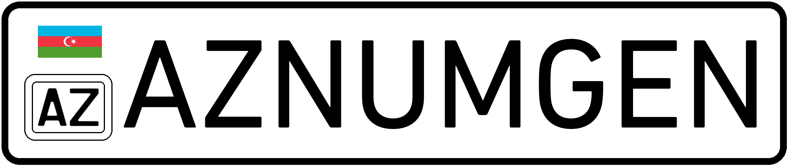
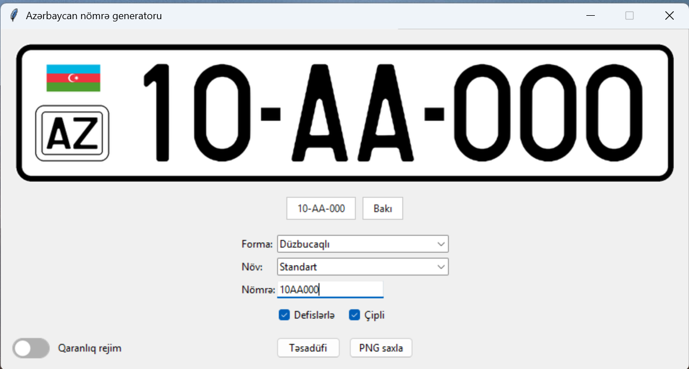
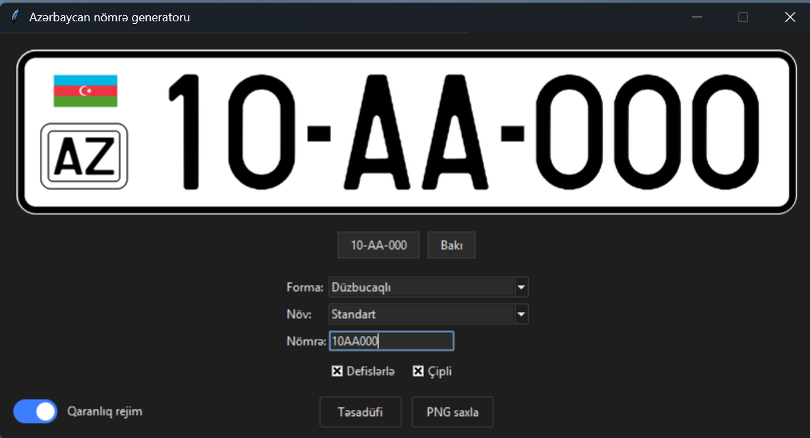
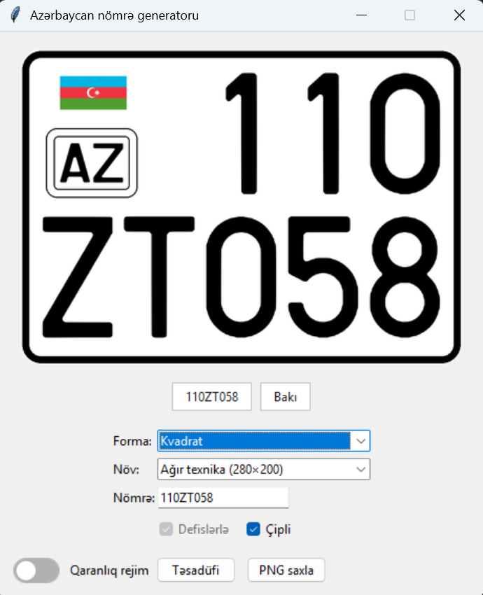
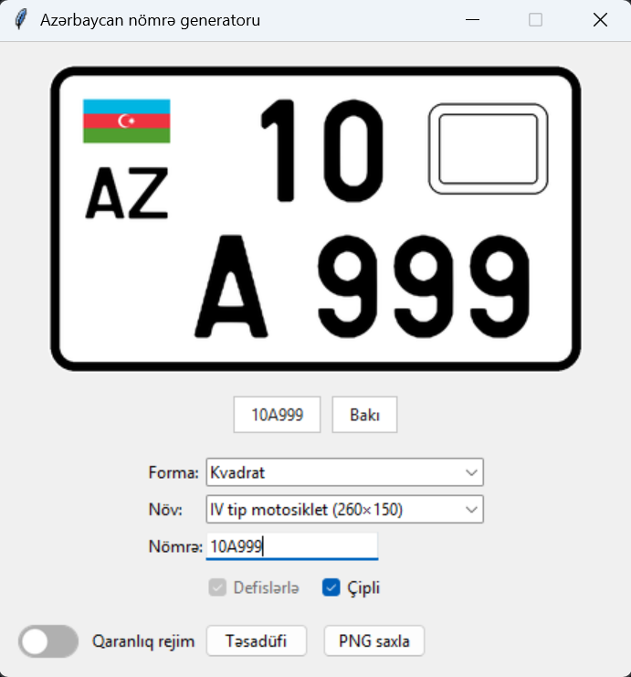
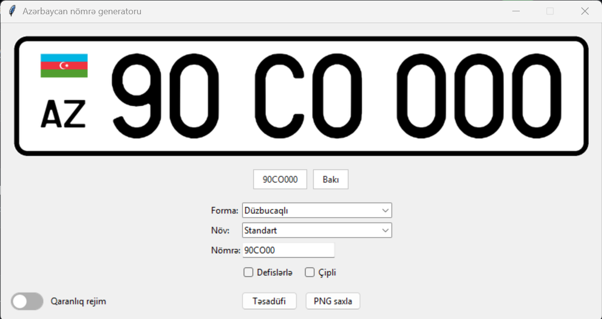

<p align="center">
  
</p>

<p align="center">
  A desktop GUI for generating Azerbaijani license plate images.
</p>

<p align="center">
  
  
  
</p>


## Features
- Rectangular and square plates, with exact dimensions from the standard
- Region name for every region code, including 3-digit heavy machinery codes (100, 110, 185)
- Options for dashes and the RFID chip frame
- Light and dark mode
- Export as a high-resolution PNG (4 px per mm)

## Screenshots

| Light mode | Dark mode |
|---|---|
|  |  |

| Heavy machinery | Motorcycle |
|---|---|
|  |  |

| Without dashes and chip |
|---|
|  |

## Download

Get the latest version from [Releases](https://github.com/alimetastic/aznumgen/releases/latest). No Python needed.

**Windows (64-bit):** 
Download `aznumgen-winx64-v0.1.zip`, unzip it and run `aznumgen.exe`.
Windows may show "Windows protected your PC" the first time. Click **More info - Run anyway**.

**Linux (x86_64, Ubuntu 24.04 or newer):**

```bash
tar -xzf aznumgen-x86_64-v0.1.tar.gz
./aznumgen/install.sh
```

Then search for "Azərbaycan nömrə generatoru" in your app menu.

## Fonts

For the most accurate look, put `AZPlate.otf` (77 mm characters) and `AZPlate50.otf` (50 mm characters).
Without them the app falls back to Bahnschrift, then Arial, then DejaVu Sans. The release builds already include both fonts.

## Disclaimer

The images are for design, education and mockups only. They are not official plates and must not be used on a vehicle.

## License

[MIT](LICENSE)
